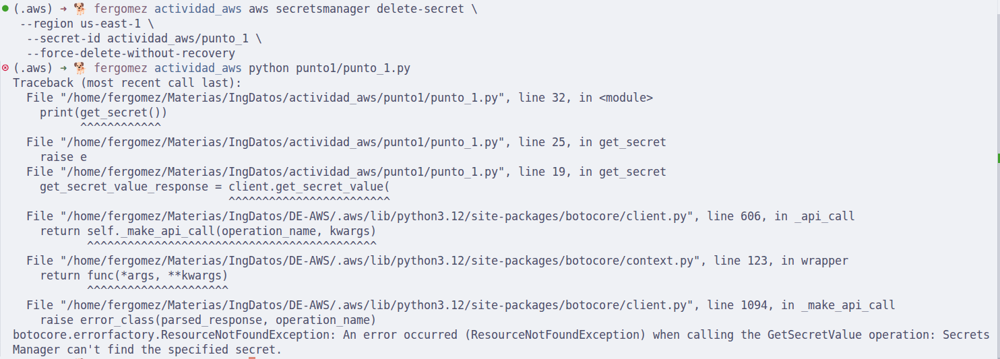

# Punto 1 - AWS Secrets Manager

## Que es AWS Secrets Manager

Es un servicio de AWS que permite almacenar, administrar y recuperar informacion sensible como contrasenas, claves de API, tokens y credenciales de bases de datos. Evita tener secretos hardcodeados en el codigo.

## Que tipo de informacion permite guardar

- Contrasenas de bases de datos (RDS, DocumentDB, Redshift, etc.)
- Claves de API
- Tokens OAuth
- Credenciales en formato JSON (pares clave-valor arbitrarios)
- Certificados TLS
- Cualquier texto o binario de hasta 64 KB

## Como se controla quien puede leer un secreto

Mediante **politicas de IAM**. Se crea una politica que permite la accion `secretsmanager:GetSecretValue` sobre el ARN especifico del secreto, y se asigna al usuario o rol que lo necesite. Tambien se puede usar una politica basada en recurso directamente en el secreto. Si el secreto esta cifrado con una KMS key personalizada, el usuario tambien necesita permiso `kms:Decrypt`.

## Diferencia entre crear, recuperar y rotar un secreto

- **Crear**: se almacena el secreto en Secrets Manager (consola, CLI o SDK). Se define nombre, valor (clave-valor JSON), cifrado (KMS) y opcionalmente rotacion.
- **Recuperar**: la aplicacion llama a `GetSecretValue` en tiempo de ejecucion para obtener el valor actual. Nunca se escribe el secreto en el codigo.
- **Rotar**: Secrets Manager cambia automaticamente el valor del secreto segun un calendario, usando una funcion Lambda. El servicio actualiza tanto el secreto como la credencial en el recurso asociado (por ejemplo, la contrasena de una BD en RDS).

## Politica de acceso usada

```json
{
  "Version": "2012-10-17",
  "Statement": [
    {
      "Effect": "Allow",
      "Action": "secretsmanager:GetSecretValue",
      "Resource": "arn:aws:secretsmanager:us-east-1:<ACCOUNT_ID>:secret:actividad_aws/punto_1-*"
    }
  ]
}
```

Esta politica permite **solo lectura** del secreto especifico `actividad_aws/punto_1`. No permite crear, eliminar ni modificar secretos.

## Como se actualiza el secreto sin cambiar el codigo

Se modifica el valor del secreto desde la consola o CLI:

```bash
aws secretsmanager put-secret-value \
  --secret-id actividad_aws/punto_1 \
  --secret-string '{"username":"nuevo_usuario","password":"nueva_contrasena"}'
```

El programa Python (`punto_1.py`) siempre llama a `GetSecretValue` en cada ejecucion, por lo que obtiene automaticamente el valor mas reciente sin necesidad de modificar el codigo.

## Preguntas de costos

### Como se cobran los secretos almacenados y las llamadas a la API?

- **Almacenamiento**: $0.40 USD por secreto por mes.
- **Llamadas a la API**: $0.05 USD por cada 10,000 llamadas.

### Que ocurre con el costo si el programa consulta el mismo secreto repetidamente?

Cada llamada a `GetSecretValue` cuenta como una llamada a la API y se cobra. Si el programa consulta el secreto muchas veces (por ejemplo, en cada request de una aplicacion web), el costo de API se acumula. Con 1 millon de llamadas al mes el costo seria de $5 USD solo en llamadas.

### Cuando convendria guardar temporalmente el valor en memoria?

Cuando la aplicacion consulta el secreto con alta frecuencia (multiples veces por minuto). Se puede cachear el valor en memoria con un TTL (por ejemplo, 5 minutos) y solo volver a llamar a la API cuando expire. Esto reduce costos y latencia. AWS ofrece la libreria de caching para esto. No conviene cachear si el secreto cambia muy frecuentemente y se necesita el valor actualizado de inmediato.

## Estimacion de costos para esta practica

| Concepto | Costo estimado |
|----------|---------------|
| 1 secreto almacenado (unos dias) | ~$0.02 USD |
| ~50 llamadas a la API (pruebas) | ~$0.00 USD |
| **Total** | **~$0.02 USD** |

## Codigo Python

Ver archivo `punto_1.py` en este directorio.

## Eliminacion del secreto

El secreto de prueba fue eliminado al finalizar la practica:

```bash
aws secretsmanager delete-secret \
  --secret-id actividad_aws/punto_1 \
  --force-delete-without-recovery
```
