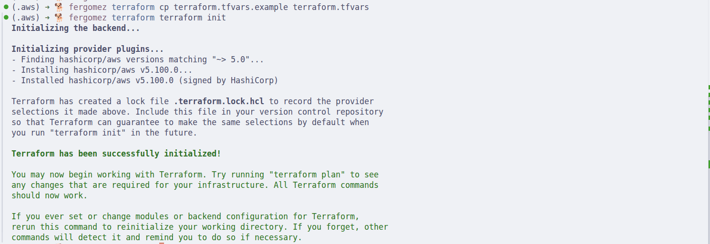
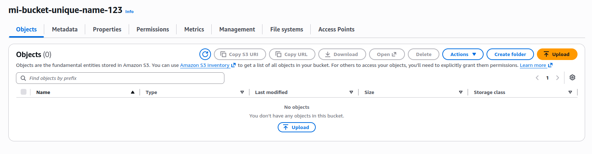
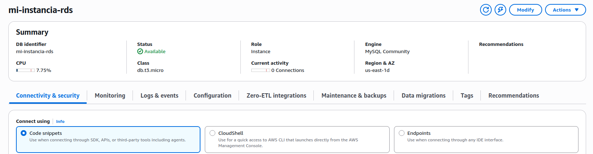
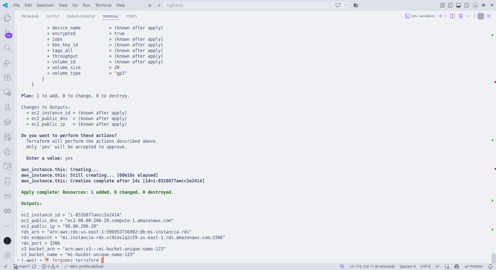
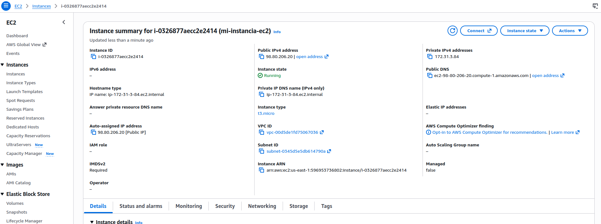

# Punto 2 - Despliegue con Terraform, SDK y AWS CLI

## Que es Terraform

Terraform es una herramienta de Infrastructure as Code (IaC) de HashiCorp. Permite definir infraestructura en archivos de configuracion `.tf` usando un lenguaje declarativo llamado HCL. En lugar de crear recursos manualmente en la consola, se describe el estado deseado y Terraform se encarga de crearlo.

El flujo de trabajo basico es:

1. **Definir**: escribir archivos `.tf` que describen los recursos (S3, EC2, RDS, etc.)
2. **Planificar**: `terraform plan` muestra que cambios se van a hacer sin ejecutarlos
3. **Crear**: `terraform apply` crea la infraestructura real en AWS
4. **Eliminar**: `terraform destroy` elimina todos los recursos creados

Terraform guarda el estado actual de la infraestructura en un archivo `terraform.tfstate`, y lo compara contra la configuracion para saber que debe crear, modificar o eliminar.

## Configuracion del usuario IAM user_cli

El usuario `user_cli` se configuro con acceso programatico (access key + secret key). Los permisos necesarios para este punto son:

**S3**: `s3:CreateBucket`, `s3:DeleteBucket`, `s3:ListBucket`, `s3:ListAllMyBuckets`

**EC2**: `ec2:RunInstances`, `ec2:TerminateInstances`, `ec2:DescribeInstances`, `ec2:CreateSecurityGroup`, `ec2:DeleteSecurityGroup`, `ec2:AuthorizeSecurityGroupIngress`, `ec2:CreateTags`, `ec2:DescribeVpcs`, `ec2:DescribeSubnets`, `ec2:DescribeSecurityGroups`, `ec2:DescribeImages`

**RDS**: `rds:CreateDBInstance`, `rds:DeleteDBInstance`, `rds:DescribeDBInstances`, `rds:CreateDBSubnetGroup`, `rds:DeleteDBSubnetGroup`, `rds:AddTagsToResource`

**Secrets Manager** (para la contrasena de RDS): `secretsmanager:GetSecretValue`, `secretsmanager:DescribeSecret`

**Red**: `ec2:DescribeAvailabilityZones`, `ec2:DescribeRouteTables`, `ec2:DescribeInternetGateways`

## Como autentica user_cli las herramientas

Las tres herramientas (AWS CLI, Boto3 y Terraform) se autentican de la misma forma: usando las credenciales del usuario IAM configuradas con `aws configure`.

```bash
aws configure --profile user_cli
# AWS Access Key ID: AKIA...
# AWS Secret Access Key: ...
# Default region name: us-east-1
# Default output format: json
```

Esto guarda las credenciales en `~/.aws/credentials`. Las tres herramientas leen ese archivo automaticamente.

**Importante**: las access keys de IAM **no** se guardan en Secrets Manager. Las herramientas necesitan autenticarse en AWS _antes_ de poder leer cualquier secreto, asi que seria un problema circular. Las access keys se configuran localmente y se protegen con permisos del sistema operativo.

## Que informacion conserva Terraform en su archivo de estado

El archivo `terraform.tfstate` guarda el estado completo de los recursos creados, incluyendo:

- IDs de recursos (instance ID, bucket name, etc.)
- Configuraciones aplicadas
- **Valores sensibles en texto plano** (contrasenas, tokens, etc.)

Por eso es importante:

- **No commitear** `terraform.tfstate` al repositorio (agregarlo a `.gitignore`)
- **No pasar contrasenas** directamente en variables de Terraform, ya que quedan en el state
- Usar `manage_master_user_password = true` en RDS para que Secrets Manager administre la contrasena y esta nunca aparezca en el state

## Comparacion de los tres metodos

| Aspecto | Terraform | Boto3 (Python) | AWS CLI |
|---------|-----------|----------------|---------|
| Tipo | Declarativo | Imperativo | Imperativo |
| Lenguaje | HCL | Python | Bash |
| Estado | Mantiene estado en `.tfstate` | No mantiene estado | No mantiene estado |
| Planificacion | `terraform plan` antes de aplicar | No tiene | No tiene |
| Eliminacion | `terraform destroy` elimina todo | Hay que scripting manual | Hay que scripting manual |
| Idempotencia | Si (aplica solo diferencias) | No (hay que verificar si existe) | No (hay que verificar si existe) |
| Dependencias | Resuelve automaticamente | Hay que manejar manualmente | Hay que manejar manualmente |
| Curva de aprendizaje | Media (aprender HCL) | Baja (si ya sabes Python) | Baja |
| Reproducibilidad | Alta | Media | Media |

**Terraform** es el mejor para infraestructura que se va a mantener en el tiempo, porque gestiona el estado y las dependencias. **Boto3** es util cuando se necesita logica programatica compleja. **AWS CLI** es rapido para tareas puntuales o scripts simples.

## Preguntas de costos

### Cuanto costaria mantener los recursos durante una hora y durante una semana?

Usando la configuracion de menor costo (`us-east-1`):

| Recurso | Costo/hora | Costo/semana (168h) |
|---------|-----------|-------------------|
| EC2 t2.micro | $0.0116 | $1.95 |
| RDS db.t3.micro (MySQL) | $0.017 | $2.86 |
| S3 bucket (vacio) | $0.00 | $0.00 |
| EBS volume 20GB (gp3) | $0.0011 | $0.18 |
| **Total** | **~$0.03** | **~$5.00** |

Nota: EC2 t2.micro y RDS db.t3.micro pueden estar cubiertos por la capa gratuita si la cuenta tiene menos de 12 meses.

### Que componentes seguirian generando cargos sin recibir trafico?

- **RDS**: se cobra por hora mientras la instancia este encendida, sin importar si recibe consultas o no
- **EC2**: se cobra por hora mientras este corriendo, sin importar si recibe conexiones
- **EBS volumes**: se cobran por GB aprovisionado, esten en uso o no
- **S3**: no cobra por un bucket vacio, pero si por almacenamiento y requests si tiene objetos

Basicamente todo excepto S3 vacio sigue cobrando aunque no haya trafico.

### Que costo anade el secreto de RDS?

- **Almacenamiento del secreto**: $0.40 USD/mes
- **Llamadas a la API** (GetSecretValue): $0.05 por cada 10,000 llamadas
- Para esta practica (pocas llamadas, pocos dias): el costo adicional es **menor a $0.05 USD**

Es un costo minimo comparado con el de EC2 y RDS.


## Evidencias Terraform








