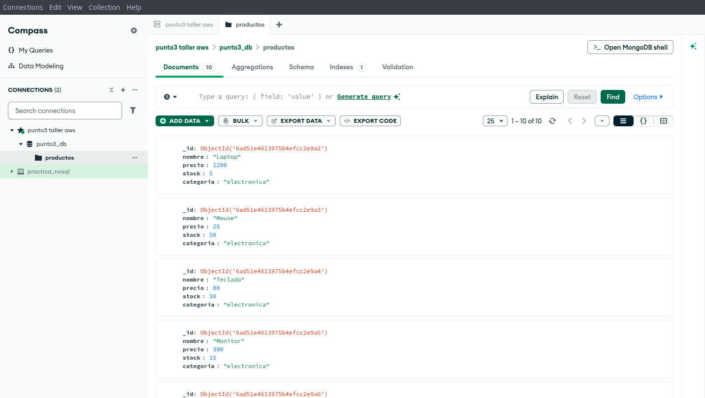
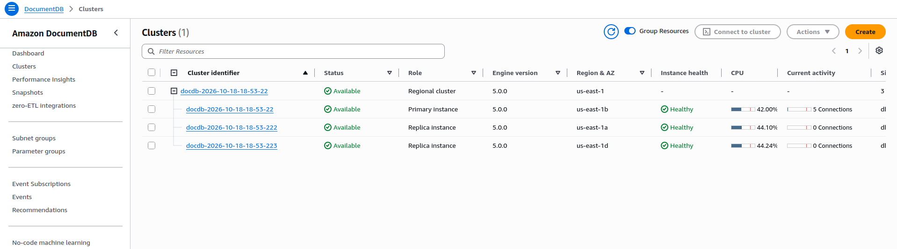
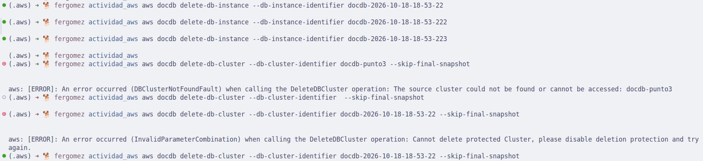

# Punto 3 - Amazon DocumentDB

## Comparacion DocumentDB vs MongoDB

| Aspecto | DocumentDB | MongoDB |
|---------|-----------|---------|
| **API soportada** | Compatible con MongoDB 3.6/4.0/5.0, pero no soporta todas las operaciones. Algunas etapas de agregacion y operadores no estan disponibles. | API completa y nativa, todas las operaciones disponibles. |
| **Arquitectura de almacenamiento** | Storage distribuido separado del computo, replicado 6 veces en 3 AZs automaticamente. No usa sharding tradicional. | Usa replica sets y sharding manual para escalar. El almacenamiento esta acoplado a cada nodo. |
| **Retryable writes** | No soporta `retryWrites=true`. Hay que usar `retryWrites=false` en la conexion. | Soporta retryable writes de forma nativa desde MongoDB 3.6. |

Estas diferencias pueden afectar una aplicacion existente porque: (1) consultas de agregacion complejas pueden fallar si usan operadores no soportados, (2) la falta de sharding nativo limita el escalamiento horizontal de escritura, y (3) hay que modificar connection strings para desactivar retryable writes.

## Despliegue elegido: Aprovisionada vs Serverless

### Comparacion de costos (us-east-1, 3 horas de uso)

**Aprovisionada (db.t3.medium, 1 instancia):**
- \$0.073/hora x 3h = \$0.22
- Elegible para free trial de DocumentDB (750 horas gratis por 30 dias)
- Con free trial: **\$0.00**

**Serverless (0.5 DCU minimo):**
- \$0.0822/DCU-hora x 0.5 DCU x 3h = \$0.12
- No elegible para free trial

**Decision:** Se uso **instancia aprovisionada db.t3.medium** porque la cuenta es elegible para el free trial de DocumentDB, lo que hace que el costo de computo sea \$0.00 durante las pruebas.

## Diagrama de conexion

```
┌──────────────────────┐
│   Computador local   │
│  (MongoDB Compass /  │
│    Python script)    │
│  localhost:27017     │
└──────────┬───────────┘
           │
           │ SSH Tunnel (-L 27017:endpoint:27017)
           │ Puerto 22
           │
┌──────────▼───────────┐
│   EC2 Bastion Host   │
│   (t3.micro)         │
│   Amazon Linux 2023  │
│   VPC por defecto    │
│   Subnet publica     │
└──────────┬───────────┘
           │
           │ TCP Puerto 27017
           │ Security Groups auto-configurados
           │
┌──────────▼───────────┐
│   Amazon DocumentDB  │
│   (db.t3.medium)     │
│   Engine 5.0         │
│   VPC por defecto    │
│   TLS habilitado     │
└──────────┬───────────┘
           │
┌──────────▼───────────┐
│   Secrets Manager    │
│   (password admin)   │
└──────────────────────┘
```

## Configuracion paso a paso

### 1. Crear EC2 bastion

- AMI: Amazon Linux 2023
- Tipo: t3.micro (free tier)
- Key pair: my-key-pair
- Security group: bastion-sg (SSH puerto 22)
- VPC: default, subnet publica con IP publica

### 2. Crear cluster DocumentDB

- Cluster type: Instance-based
- Engine version: 5.0.0
- Instance class: db.t3.medium (1 instancia)
- Connectivity: **"Connect to an EC2 compute resource"** → seleccionar la EC2 bastion
  - AWS configura automaticamente los security groups entre EC2 y DocumentDB
- Authentication: **"Managed in AWS Secrets Manager"**

### 3. Descargar certificado TLS

```bash
wget https://truststore.pki.rds.amazonaws.com/global/global-bundle.pem
```

### 4. Crear tunel SSH

```bash
ssh -i ~/.ssh/my-key-pair.pem \
  -L 27017:<CLUSTER_ENDPOINT>:27017 \
  ec2-user@<EC2_PUBLIC_IP> -N
```

### 5. Conectar con MongoDB Compass

En Compass usar Advanced Connection Options:

- **General**: Host `localhost`, Port `27017`
- **Authentication**: Username/Password con credenciales de Secrets Manager
- **TLS/SSL**: ON, CA file = `global-bundle.pem`, Allow Invalid Hostnames = ON
- **Advanced**: `directConnection=true`, `retryWrites=false`

Nota: se usa `tlsAllowInvalidHostnames=true` porque el certificado TLS es emitido para el hostname de DocumentDB, no para `localhost`. Esto es esperado cuando se usa un tunel SSH.

### 6. Ejecutar script Python

```bash
source /ruta/al/venv/bin/activate
python3 punto3/documentdb.py
```

## Resultados de las consultas

### Consulta 1: Filtro
Productos de categoria 'electronica' con precio menor a \$100:
```
- Mouse: \$25 (stock: 50)
- Teclado: \$80 (stock: 30)
- Audifonos: \$60 (stock: 40)
- Webcam: \$90 (stock: 20)
```

### Consulta 2: Ordenacion
Todos los productos ordenados por precio (mayor a menor):
```
- Laptop: $1200 (electronica)
- Escritorio: $350 (muebles)
- Monitor: $300 (electronica)
- Silla: $150 (muebles)
- Microfono: $120 (electronica)
- Webcam: $90 (electronica)
- Teclado: $80 (electronica)
- Audifonos: $60 (electronica)
- Lampara: $45 (iluminacion)
- Mouse: $25 (electronica)
```

### Consulta 3: Agregacion
Precio promedio y stock total por categoria:
```
- electronica: precio promedio $267.86, stock total 172, 7 productos
- muebles: precio promedio $250.00, stock total 18, 2 productos
- iluminacion: precio promedio $45.00, stock total 25, 1 productos
```

## Preguntas de costos

### Que opcion de DocumentDB cuesta menos para esta practica?

Para esta practica (unas pocas horas de uso):

| Opcion | Costo estimado |
|--------|---------------|
| Aprovisionada db.t3.medium (con free trial) | \$0.00 |
| Aprovisionada db.t3.medium (sin free trial, 3h) | \$0.22 |
| Serverless 0.5 DCU (3h) | \$0.12 |

Si la cuenta tiene free trial activo, **aprovisionada es gratis**. Sin free trial, **Serverless es mas barato** para uso corto e intermitente.

### Cuanto agrega la EC2 del tunel?

- EC2 t3.micro: \$0.0104/hora
- 3 horas de uso: **\$0.03**
- Si la cuenta tiene free tier de EC2 (750 horas/mes t3.micro): **\$0.00**

La EC2 bastion es necesaria porque DocumentDB no permite conexion publica. El costo adicional es minimo.

### Estimacion total

| Recurso | Costo (3h, con free trial/tier) | Costo (3h, sin free trial/tier) |
|---------|------|------|
| DocumentDB db.t3.medium | \$0.00 | \$0.22 |
| EC2 t3.micro | \$0.00 | \$0.03 |
| Secrets Manager (1 secreto) | ~\$0.01 | ~\$0.01 |
| Storage DocumentDB (< 1GB) | ~\$0.00 | ~\$0.00 |
| **Total** | **~\$0.01** | **~\$0.26** |

## Eliminacion de recursos

```bash
# 1. Eliminar instancia DocumentDB
aws docdb delete-db-instance --db-instance-identifier <INSTANCE_ID>

# 2. Esperar y eliminar cluster
aws docdb delete-db-cluster --db-cluster-identifier docdb-punto3 --skip-final-snapshot

# 3. Terminar EC2 bastion
aws ec2 terminate-instances --instance-ids <EC2_ID>

# 4. Eliminar security groups (despues de que EC2 y DocDB esten eliminados)
aws ec2 delete-security-group --group-id <SG_DOCDB_ID>
aws ec2 delete-security-group --group-id <SG_EC2_DOCDB_ID>

# 5. Eliminar secreto
aws secretsmanager delete-secret --secret-id <SECRET_ARN> --force-delete-without-recovery
```

## Evidencias




