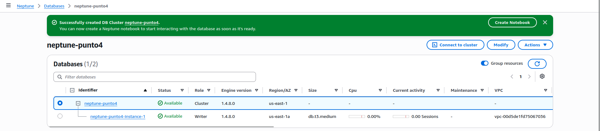
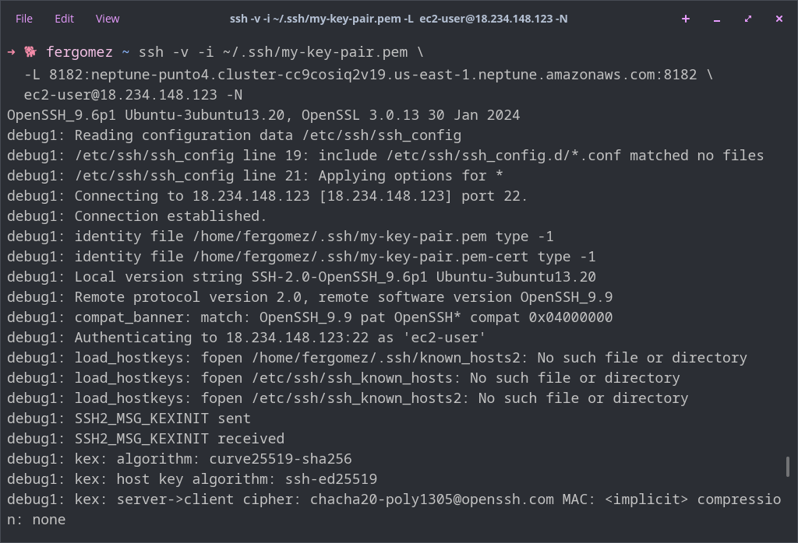
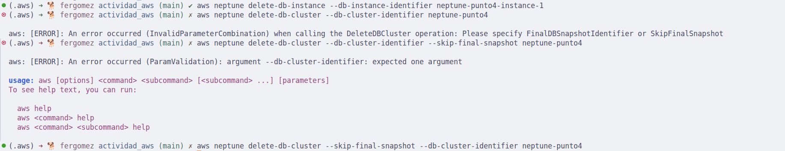

# Punto 4 - Amazon Neptune

## Comparacion Neptune vs Neo4j

| Aspecto | Amazon Neptune | Neo4j |
|---------|---------------|-------|
| **Modelo de datos** | Soporta property graphs (Gremlin/openCypher) y RDF (SPARQL). Dos modelos en un mismo motor. | Solo property graphs. Modelo unico pero mas profundo y optimizado para ese caso. |
| **Lenguajes de consulta** | Gremlin (Apache TinkerPop), openCypher y SPARQL. Tres opciones segun el modelo. | Cypher como lenguaje nativo y principal. Soporte parcial de Gremlin via plugin. |
| **Herramientas** | Neptune Workbench (Jupyter), consola AWS, no tiene visualizador de grafos integrado. Se accede via API o SDK. | Neo4j Browser (visualizador interactivo), Neo4j Bloom (exploracion visual), Neo4j Desktop. Herramientas mas maduras para desarrollo. |
| **Despliegue** | Servicio administrado en AWS. Solo corre en AWS, dentro de una VPC. | Se puede instalar on-premise, en Docker, o usar Neo4j Aura (cloud). Mas flexible en donde correr. |
| **Acceso** | Sin acceso publico directo. Requiere VPC + bastion/tunnel. | Neo4j Aura tiene acceso publico directo. Self-hosted se configura como se quiera. |

## Eleccion: Aprovisionada vs Serverless

### Comparacion de costos (us-east-1, 3 horas)

**Aprovisionada (db.t3.medium):**
- \$0.092/hora x 3h = **$0.28**
- Predecible, costo fijo por hora

**Serverless (minimo 1 NCU):**
- \$0.1098/NCU-hora x 1 NCU x 3h = **$0.33**
- Escala automaticamente, pero minimo 1 NCU

**Decision:** Se uso **aprovisionada db.t3.medium** porque es ligeramente mas barata para un uso corto y fijo de pocas horas. Serverless tiene sentido para cargas variables o intermitentes, pero para una prueba continua de 2-3 horas, aprovisionada es mas economica.

## Acceso a Neptune desde local

### Es necesario EC2? Existe otra manera?

**Si, EC2 (o algun recurso dentro de la VPC) es necesario.** Neptune no ofrece acceso publico directo en disponibilidad general. Las alternativas son:

1. **Tunel SSH via EC2** (lo que usamos) - lo mas simple y barato
2. **AWS Cloud9** dentro de la misma VPC - entorno de desarrollo en la nube
3. **VPN site-to-site o Client VPN** - conectar tu red local a la VPC
4. **VPC Peering** - si tienes otra VPC con acceso

Para esta practica, el **tunel SSH via EC2** es la opcion mas simple y economica.

## Diagrama de conexion

```
┌──────────────────────┐
│   Computador local   │
│   (Python script)    │
│   localhost:8182     │
└──────────┬───────────┘
           │
           │ SSH Tunnel (-L 8182:endpoint:8182)
           │ Puerto 22
           │
┌──────────▼───────────┐
│   EC2 Bastion Host   │
│   (t3.micro)         │
│   Amazon Linux 2023  │
│   neptune-bastion-sg │
│   (SSH port 22)      │
└──────────┬───────────┘
           │
           │ TCP Puerto 8182
           │ neptune-sg permite
           │ ingreso desde bastion-sg
           │
┌──────────▼───────────┐
│   Amazon Neptune     │
│   (db.t3.medium)     │
│   Engine 1.4.8       │
│   Gremlin + SPARQL   │
│   + openCypher       │
└──────────────────────┘
```

### Configuracion de red

- **VPC**: default VPC (la misma para EC2 y Neptune)
- **Security group EC2** (`neptune-bastion-sg`): inbound SSH (22) desde mi IP
- **Security group Neptune** (`neptune-sg`): inbound TCP 8182 desde `neptune-bastion-sg`
- **Autenticacion**: IAM auth deshabilitado (Neptune no usa usuario/password como DocumentDB)
- **TLS**: habilitado por defecto, se maneja con `ssl.CERT_NONE` en el cliente porque el hostname no coincide con `localhost` al usar tunnel

### Comando del tunel SSH

```bash
ssh -i ~/.ssh/my-key-pair.pem \
  -L 8182:<NEPTUNE_ENDPOINT>:8182 \
  ec2-user@<EC2_PUBLIC_IP> -N
```

## Modelo del grafo

### Vertices (11)

| Tipo | Nombre | Propiedades |
|------|--------|-------------|
| estudiante | Ana | semestre: 9, programa: Ing-Datos |
| estudiante | Carlos | semestre: 8, programa: Ing-Datos |
| estudiante | Maria | semestre: 9, programa: Ing-Sistemas |
| estudiante | Pedro | semestre: 7, programa: Ing-Sistemas |
| profesor | Dr. Lopez | especialidad: Bases de Datos |
| profesor | Dr. Garcia | especialidad: Redes |
| profesor | Dr. Martinez | especialidad: IA |
| curso | Bases de Datos | codigo: BD-101, creditos: 4 |
| curso | Redes | codigo: RED-201, creditos: 3 |
| curso | IA | codigo: IA-301, creditos: 4 |
| curso | Ingenieria de Datos | codigo: ID-401, creditos: 3 |

### Relaciones (16)

| Tipo | Desde | Hacia |
|------|-------|-------|
| CURSA (x8) | Ana → Bases de Datos, Ingenieria de Datos | |
| | Carlos → Bases de Datos, IA | |
| | Maria → Redes, IA | |
| | Pedro → Redes, Ingenieria de Datos | |
| IMPARTE (x4) | Dr. Lopez → Bases de Datos, Ingenieria de Datos | |
| | Dr. Garcia → Redes | |
| | Dr. Martinez → IA | |
| AMIGO_DE (x4) | Ana → Carlos, Maria | |
| | Carlos → Pedro | |
| | Maria → Pedro | |

## Resultados de las consultas

### Consulta 1: Cursos de Ana y sus profesores
Recorrido: Ana --CURSA--> curso <--IMPARTE-- profesor

```
Cursos que Ana cursa:
  - Ingenieria de Datos
    Impartido por: Dr. Lopez
  - Bases de Datos
    Impartido por: Dr. Lopez
```

### Consulta 2: Amigos de Carlos y que cursos toman
Recorrido: Carlos --AMIGO_DE--> amigo --CURSA--> curso (2 saltos)

```
Amigos de Carlos:
  - Pedro cursa:
      * Redes
      * Ingenieria de Datos
```

### Consulta 3: Popularidad de cursos (estudiantes por curso)
Recorrido: curso <--CURSA-- estudiantes, curso <--IMPARTE-- profesor

```
Redes (2 estudiantes) - Profesor: Dr. Garcia
  - Maria
  - Pedro
Inteligencia Artificial (2 estudiantes) - Profesor: Dr. Martinez
  - Maria
  - Carlos
Ingenieria de Datos (2 estudiantes) - Profesor: Dr. Lopez
  - Ana
  - Pedro
Bases de Datos (2 estudiantes) - Profesor: Dr. Lopez
  - Ana
  - Carlos
```

## Preguntas de costos

### Cuanto cuestan el computo y el almacenamiento?

| Recurso | Precio | Costo (3h) |
|---------|--------|-----------|
| Neptune db.t3.medium (computo) | $0.092/hora | $0.28 |
| Storage Neptune (< 1GB) | $0.10/GB-mes | ~$0.00 |
| I/O (Standard) | $0.20/millon | ~$0.00 |

### Su metodo de conexion anade una instancia EC2?

Si. El tunel SSH requiere una instancia EC2 bastion (t3.micro) en la misma VPC:

| Recurso | Precio | Costo (3h) |
|---------|--------|-----------|
| EC2 t3.micro | $0.0104/hora | $0.03 |

Con free tier de EC2 el costo es $0.00.

### Que se sigue cobrando mientras no ejecuta consultas?

- **Neptune instance**: se cobra por hora mientras este encendida, sin importar si recibe consultas o no
- **Neptune storage**: se cobra por GB almacenado, aunque no haya actividad
- **EC2 bastion**: se cobra por hora mientras este corriendo
- **I/O**: no se cobra si no hay actividad

Para evitar costos innecesarios, hay que **eliminar** el cluster de Neptune y terminar la EC2 al finalizar. Neptune no ofrece opcion de "stop" como EC2 o DocumentDB.

### Estimacion total

| Recurso | Costo (3h) |
|---------|-----------|
| Neptune db.t3.medium | $0.28 |
| EC2 t3.micro (free tier) | $0.00 |
| Storage (< 1 GB) | $0.00 |
| I/O | $0.00 |
| **Total** | **~$0.28** |

## Nota sobre Secrets Manager

Neptune no usa autenticacion por usuario/contrasena. Usa IAM authentication o conexion sin autenticacion. Por lo tanto, **no se requiere Secrets Manager** para Neptune. Esto se documenta porque el PDF indica usar Secrets Manager cuando el servicio ofrezca administracion integrada, y Neptune no lo ofrece.

## Eliminacion de recursos

```bash
# 1. Eliminar instancia Neptune
aws neptune delete-db-instance --db-instance-identifier <INSTANCE_ID>

# 2. Esperar y eliminar cluster
aws neptune delete-db-cluster --db-cluster-identifier neptune-punto4 --skip-final-snapshot

# 3. Terminar EC2 bastion
aws ec2 terminate-instances --instance-ids <EC2_ID>

# 4. Eliminar security groups
aws ec2 delete-security-group --group-id <SG_NEPTUNE_ID>
aws ec2 delete-security-group --group-id <SG_BASTION_ID>

# 5. Eliminar subnet group si se creo
aws neptune delete-db-subnet-group --db-subnet-group-name <SUBNET_GROUP>
```

## Evidencias 




