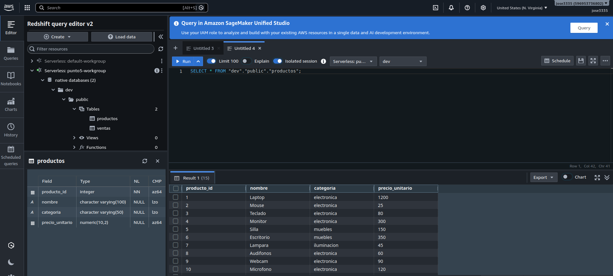

# Punto 5 - Amazon Redshift

## Que es Amazon Redshift

Amazon Redshift es un servicio de data warehouse en la nube, disenado para consultas analiticas sobre grandes volumenes de datos (OLAP). Usa almacenamiento columnar y procesamiento paralelo masivo (MPP) para ejecutar consultas SQL sobre terabytes o petabytes de datos de forma rapida.

### Componentes principales

- **Clusters/Workgroups**: la unidad de computo que ejecuta las consultas
- **Namespaces**: agrupacion logica de bases de datos y usuarios
- **Nodos**: instancias de computo dentro de un cluster (leader node + compute nodes)
- **Redshift Managed Storage (RMS)**: almacenamiento separado del computo, escala independientemente
- **Data API**: API HTTP para ejecutar SQL sin conexion directa JDBC/ODBC
- **Spectrum**: motor para consultar datos directamente en S3 sin cargarlos a Redshift

## Comparacion con Amazon RDS

| Aspecto | Amazon Redshift (OLAP) | Amazon RDS (OLTP) |
|---------|----------------------|-------------------|
| **Proposito** | Analitica, reportes, BI sobre datos historicos | Transacciones en tiempo real (CRUD) |
| **Tipo de carga** | Lecturas masivas, pocas escrituras | Muchas lecturas y escrituras pequenas |
| **Almacenamiento** | Columnar (optimizado para agregaciones) | Por filas (optimizado para registros individuales) |
| **Escala** | Petabytes, millones de filas por consulta | Gigabytes a terabytes, consultas puntuales |
| **Latencia** | Segundos a minutos (consultas complejas) | Milisegundos (consultas simples) |
| **Caso de uso** | Dashboard de ventas del ultimo ano, analisis de tendencias | Registro de un pedido, login de usuario |

**Cuando elegir Redshift**: cuando necesitas analizar grandes volumenes de datos historicos, hacer reportes y agregaciones complejas.

**Cuando elegir RDS**: cuando necesitas una base de datos transaccional para una aplicacion web, con lecturas y escrituras rapidas de registros individuales.

## Eleccion: Serverless vs Aprovisionada

### Comparacion de costos (us-east-1)

**Redshift Serverless:**
- $0.375/RPU-hora, minimo 8 RPU base
- $3.00/hora cuando esta activo
- $0/hora cuando esta inactivo (se apaga automaticamente)
- Free trial: $300 credito por 90 dias para cuentas nuevas
- Para esta practica (~15 min de computo): **~$0.75** (o $0.00 con free trial)

**Redshift Aprovisionada (dc2.large, minimo):**
- $0.25/hora, cobro continuo mientras el cluster existe
- 3 horas: **$0.75**
- Hay que pausar/reanudar manualmente

**Decision:** Se uso **Redshift Serverless** porque:
1. Solo se cobra por el tiempo de computo real (no idle)
2. Hay free trial de $300 disponible
3. No requiere pausar/reanudar manualmente
4. Se apaga solo cuando no hay queries

## Dataset

Dos tablas relacionadas por `producto_id`:

### Tabla: productos (15 filas)
| Campo | Tipo | Descripcion |
|-------|------|-------------|
| producto_id | INTEGER PK | ID unico |
| nombre | VARCHAR(100) | Nombre del producto |
| categoria | VARCHAR(50) | electronica, muebles, iluminacion |
| precio_unitario | DECIMAL(10,2) | Precio por unidad |

### Tabla: ventas (25 filas)
| Campo | Tipo | Descripcion |
|-------|------|-------------|
| venta_id | INTEGER PK | ID unico |
| producto_id | INTEGER FK | Referencia a productos |
| cantidad | INTEGER | Unidades vendidas |
| precio_total | DECIMAL(10,2) | Ingreso total de la venta |
| fecha | DATE | Fecha de la venta |

Los archivos CSV estan en `punto5/data/`.

## Arquitectura

```
┌──────────────────────┐
│   Python script      │
│   (boto3 Data API)   │
└──────────┬───────────┘
           │ AWS API calls
           │ (no conexion directa)
           │
    ┌──────▼──────┐
    │  Redshift   │──── Secrets Manager (password)
    │  Serverless │
    │  Data API   │
    └──────┬──────┘
           │ COPY
    ┌──────▼──────┐
    │     S3      │──── datos CSV
    │  (bucket)   │
    └─────────────┘
           │
    ┌──────▼──────┐
    │  IAM Role   │──── RedshiftS3ReadRole
    └─────────────┘
```

## Instrucciones de ejecucion

### 1. Crear IAM Role

1. IAM Console → Roles → Create
2. Trusted entity: AWS service → Redshift → Redshift - Customizable
3. Permissions: `AmazonS3ReadOnlyAccess`
4. Name: `RedshiftS3ReadRole`
5. Anotar el ARN

### 2. Crear Redshift Serverless

1. Redshift Console → Serverless → Create workgroup
2. Workgroup: `punto5-workgroup`, Base: 8 RPU
3. Namespace: `punto5-namespace`, DB: `punto5db`
4. Credentials: **"Manage admin credentials in AWS Secrets Manager"**
5. IAM roles: asociar `RedshiftS3ReadRole`
6. Anotar el Secret ARN

### 3. Configurar el script

Editar `punto5/redshift.py` y completar:
```python
SECRET_ARN = "arn:aws:secretsmanager:..."
IAM_ROLE_ARN = "arn:aws:iam::...:role/RedshiftS3ReadRole"
```

### 4. Ejecutar

```bash
source /ruta/al/venv/bin/activate
python3 punto5/redshift.py
```

## Consultas y resultados

### Consulta 1: Filtro
**Pregunta**: Cuales son las ventas de productos de electronica con precio total mayor a $100?

```sql
SELECT v.venta_id, p.nombre, v.cantidad, v.precio_total, v.fecha
FROM ventas v
JOIN productos p ON v.producto_id = p.producto_id
WHERE p.categoria = 'electronica' AND v.precio_total > 100
ORDER BY v.precio_total DESC
```

**Interpretacion**: Identifica las ventas mas grandes de productos electronicos. Las laptops dominan el ingreso por unidad vendida.

### Consulta 2: Join
**Pregunta**: Detalle completo de cada venta con informacion del producto?

```sql
SELECT v.venta_id, p.nombre, p.categoria, v.cantidad,
       p.precio_unitario, v.precio_total, v.fecha
FROM ventas v
JOIN productos p ON v.producto_id = p.producto_id
ORDER BY v.fecha, v.venta_id
```

**Interpretacion**: Combina ventas y productos para obtener el detalle completo de cada transaccion, incluyendo el nombre y categoria del producto vendido.

### Consulta 3: Agregacion
**Pregunta**: Cual es el ingreso total y cantidad de ventas por categoria?

```sql
SELECT p.categoria, COUNT(v.venta_id) AS total_ventas,
       SUM(v.cantidad) AS unidades_vendidas,
       SUM(v.precio_total) AS ingreso_total,
       ROUND(AVG(v.precio_total), 2) AS ticket_promedio
FROM ventas v
JOIN productos p ON v.producto_id = p.producto_id
GROUP BY p.categoria
ORDER BY ingreso_total DESC
```

**Interpretacion**: Electronica es la categoria con mayor ingreso total y volumen de ventas. Muebles tiene menos ventas pero un ticket promedio alto. Iluminacion es la categoria con menor actividad.

## Preguntas de costos

### Que modalidad de Redshift cuesta menos para esta practica?

**Serverless** es mas barata porque:
- Solo cobra ~15 min de computo real (~$0.75)
- Se apaga automaticamente cuando no hay queries
- Con free trial ($300 credito): $0.00

Aprovisionada cobraria $0.25/hora durante todo el tiempo que el cluster exista, incluso si no ejecutas queries.

### Como se cobran el computo y el almacenamiento?

- **Computo (Serverless)**: $0.375/RPU-hora, por segundo, solo cuando hay queries activos. Minimo 8 RPU base.
- **Almacenamiento (RMS)**: $0.024/GB-mes, independiente del computo. Se cobra por datos almacenados en Redshift.
- **S3**: costos separados de almacenamiento y requests ($0.023/GB-mes).

### Que recursos podrian seguir generando cargos despues de ejecutar las consultas?

- **RMS (storage)**: los datos almacenados en Redshift siguen cobrando mientras las tablas existan
- **S3**: los archivos CSV en el bucket siguen cobrando
- **Secrets Manager**: $0.40/mes por el secreto
- **Snapshots**: si hay snapshots manuales, se cobran como backup storage
- **Computo Serverless**: $0 si no hay queries activos (se apaga solo)

Para evitar cargos: eliminar el workgroup, namespace, bucket S3 y secreto.

### Estimacion total

| Recurso | Costo |
|---------|-------|
| Redshift Serverless ~15 min (con free trial) | $0.00 |
| RMS storage (< 1 MB, unos dias) | ~$0.00 |
| S3 (< 1 KB, unos dias) | ~$0.00 |
| Secrets Manager (1 secreto) | ~$0.01 |
| **Total** | **~$0.01** |

## Eliminacion de recursos

```bash
# 1. Eliminar workgroup
aws redshift-serverless delete-workgroup --workgroup-name punto5-workgroup

# 2. Eliminar namespace
aws redshift-serverless delete-namespace --namespace-name punto5-namespace

# 3. Eliminar datos en S3
aws s3 rm s3://redshift-punto5-data --recursive
aws s3 rb s3://redshift-punto5-data

# 4. Eliminar IAM role
aws iam detach-role-policy --role-name RedshiftS3ReadRole \
  --policy-arn arn:aws:iam::aws:policy/AmazonS3ReadOnlyAccess
aws iam delete-role --role-name RedshiftS3ReadRole

# 5. Eliminar secreto
aws secretsmanager delete-secret --secret-id <SECRET_ARN> --force-delete-without-recovery
```


## Evidencias

